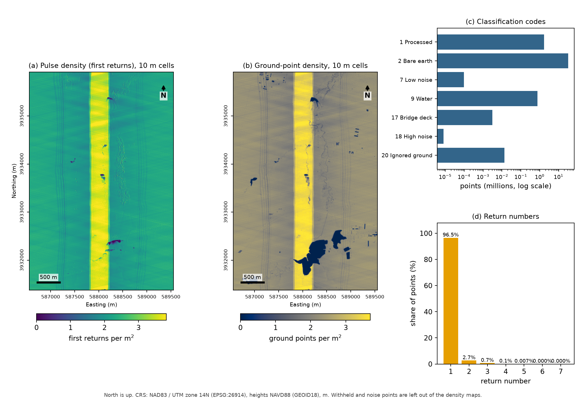
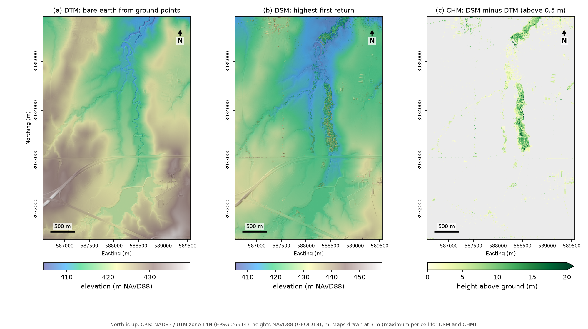
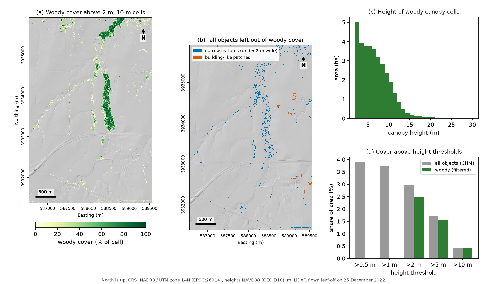
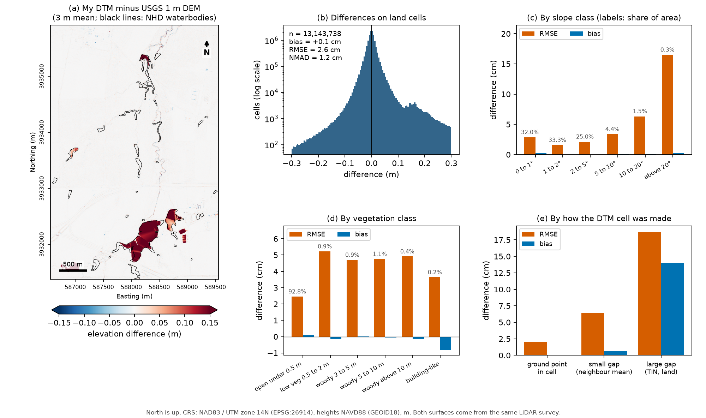
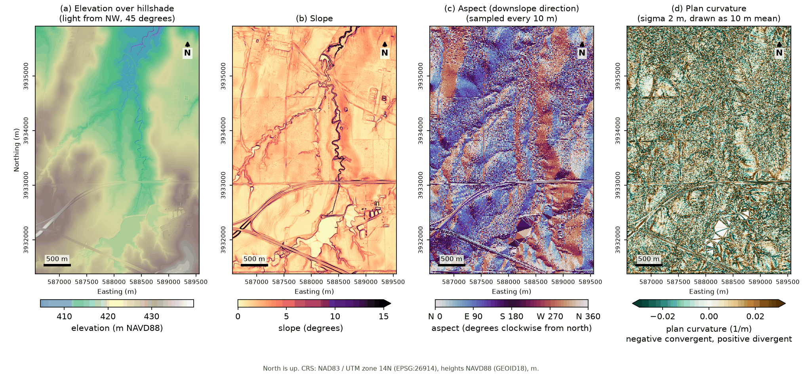
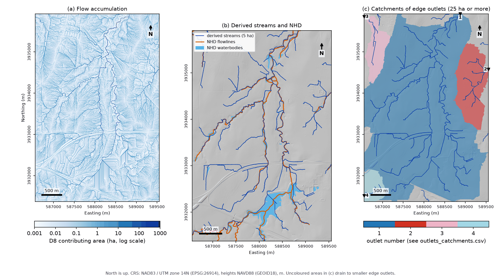
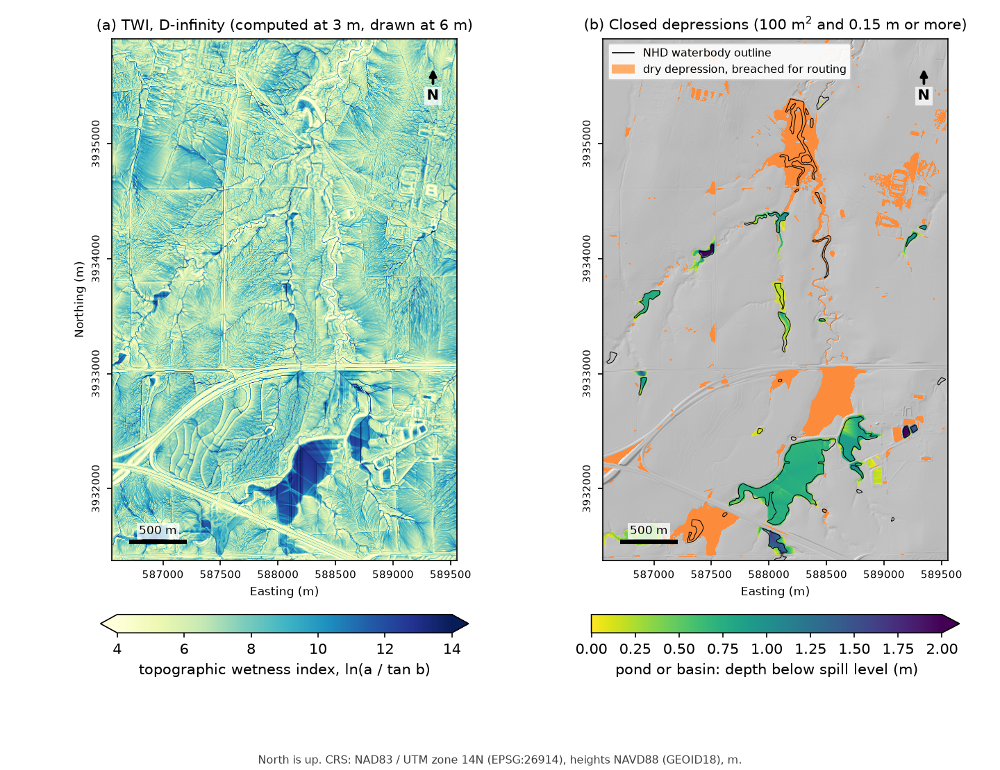
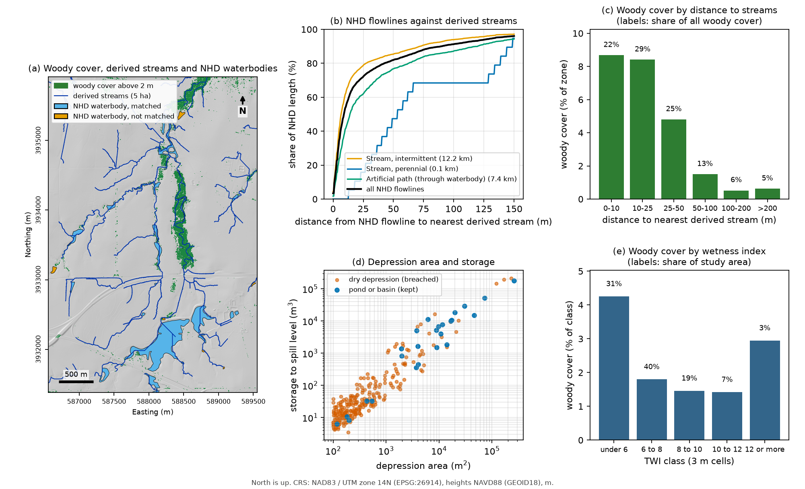

# LiDAR Terrain, Woody Cover and Surface Hydrology of a Rangeland Research Area near Fort Reno, Oklahoma

**Author:** Anamika Dristi, Ph.D.

This project starts from raw public airborne LiDAR point clouds (USGS 3DEP, six LAZ tiles, 34.0 million points) and builds terrain, vegetation and hydrology products for a 13.6 km2 block of prairie, pasture and creek bottom around the USDA-ARS research station at Fort Reno, west of El Reno, Oklahoma. All gridding is done in Python. The measured pulse density is 2.36 first returns per m2, which fits the Quality Level 2 survey. My 1 m bare-earth model (DTM) differs from the official USGS 1 m DEM by a bias of +0.1 cm and an RMSE of 2.6 cm on land cells. Both come from the same LiDAR survey, so this number shows agreement between two gridding methods and not accuracy against the true ground. Woody cover taller than 2 m is 34.1 ha, or 2.5 % of the area, and 76 % of it stands within 50 m of a derived drainage line. One outlet on the north edge drains 9.58 km2, or 70 % of the area. After I breached 259 dry hollows behind road and berm embankments, 25 ponds and basins remain with 365,000 m3 of storage between the survey-day surface and the spill level (27 mm over the study area). Where my DTM has at least 5 ha of contributing area, 91 % of the NHD flowline length lies within 10 m of my derived streams, and 28 of 34 NHD waterbodies are picked up as depressions.

This is an independent analysis of public data. It is separate from my LSU dissertation datasets and uses none of them.

## Why it matters

- **Water on rangeland.** Stock ponds, small dams and creek bottoms control where cattle can drink, where runoff collects and where soil stays wet. A 1 m terrain model shows these features directly. A 10 m or 30 m model does not.
- **Woody plant encroachment.** Trees and tall shrubs moving into grassland change forage, fire behaviour and the water balance. LiDAR gives height, so woody cover can be mapped by height class and related to drainage lines.
- **Inputs for models.** Hydrologic models such as SWAT+ and MODFLOW need a drainage network, catchments, slopes and pond storage. This workflow shows how those inputs come out of a raw point cloud, and where the weak points are (culverts, water surfaces, edges of the data).
- **Honest accuracy.** The project separates what the LiDAR vendor states, what USGS requires, and what my own comparison can and cannot show.

## Study area

- A north-up rectangle of 3,000 m by 4,539 m (13.617 km2), from 35.5222 N to 35.5629 N and 98.0454 W to 98.0118 W.
- It is the largest rectangle in UTM zone 14N that fits inside six 5,000 ft LiDAR tiles (2 columns by 3 rows).
- Elevation is 404.4 to 439.7 m NAVD88 (relief 35.3 m). The median slope is 1.5 degrees (2.6 %), and 80 % of the area is flatter than 5 %.
- The block holds native prairie and improved pasture, a wooded creek corridor, Lake Rolla (22 ha in NHD), 33 smaller NHD ponds, and Target Creek with its tributaries, which flow north toward the North Canadian River.
- It is not pure rangeland. A divided highway with an interchange and a second east-west road cross the southern half, and there are groups of buildings and several built basins. I identified these from the terrain model only and did not check them against a road map.
- I chose the tiles from maps of streams and ponds. I did not use an official boundary of the research station, so the block should be read as "the Fort Reno area" and not as the station itself.
- The request for this kind of study usually says 4 to 10 km2. I used 13.6 km2 so that the block reaches from Lake Rolla in the south to the creek outlet in the north.

## Data sources

All data are public and were downloaded without accounts or keys on 2026-11-23.

| Dataset | Provider and link | What was used |
|---|---|---|
| LiDAR point cloud (LAZ 1.4, point format 6) | USGS 3D Elevation Program, found with The National Map API (https://tnmaccess.nationalmap.gov/api/v1/products, dataset "Lidar Point Cloud (LPC)"), files on https://rockyweb.usgs.gov/vdelivery/Datasets/Staged/Elevation/LPC/Projects/OK_Statewide_D22/OK_Statewide_2_D22/LAZ/ | 6 tiles `USGS_LPC_OK_Statewide_D22_<x>_<y>.laz` with x = 1955000, 1960000 and y = 190000, 195000, 200000; 364 MB; 33,999,458 points |
| 1 m DEM (comparison product) | USGS 3DEP, https://prd-tnm.s3.amazonaws.com/StagedProducts/Elevation/1m/Projects/OK_Statewide_D22/TIFF/USGS_1M_14_x58y394_OK_Statewide_D22.tif | One tile (281 MB), window of 3,000 by 4,539 cells |
| National Hydrography Dataset, high resolution | USGS, https://prd-tnm.s3.amazonaws.com/StagedProducts/Hydrography/NHD/HU8/GPKG/NHD_H_11100301_HU8_GPKG.zip (published 2023-12-19) | `NHDFlowline` (19.7 km inside the block) and `NHDWaterbody` (34 polygons, 46.1 ha) |
| Project metadata | USGS, https://prd-tnm.s3.amazonaws.com/index.html?prefix=StagedProducts/Elevation/metadata/OK_Statewide_D22/OK_Statewide_2_D22 | USGS validation summary (PDF), LAS QC report, vendor XML metadata for the point cloud and the DEM |

`data/tnm_product_index.csv` lists what the API returned for the area, with sizes and publication dates.

Two notes on the downloads:

- The NHD ArcGIS REST service (`hydro.nationalmap.gov`) did not answer my bounding-box queries within 40 to 120 seconds, so I used the staged HUC8 GeoPackage instead. I used the NHD and not NHDPlus HR.
- The LiDAR file server allowed only about three connections at a time and about 80 to 100 kB/s each, so the six tiles took about 30 minutes.

### LiDAR project metadata

| Item | Value | Where it comes from |
|---|---|---|
| Project and work unit | OK_Statewide_D22, work unit OK_Statewide_2_D22 (ID 300454) | USGS validation summary |
| Contractor and sensors | Fugro; Riegl VQ-1560 II-S and VQ-780 II-S | Vendor XML |
| Collection dates | Project: 14 December 2022 to 26 January 2023, leaf-off. My six tiles: 25 December 2022 only | Vendor XML; GPS time of the points |
| Quality level | QL2 (Lidar Base Specification 2023 rev. A) | USGS validation summary |
| Planned density | Aggregate nominal pulse spacing 0.71 m, 2 pulses per m2 | Vendor XML |
| Measured density in my block | 2.36 first returns per m2 (spacing 0.65 m); 2.26 ground points per m2 | My step 2 |
| Horizontal CRS | NAD83(2011) / Oklahoma North, US survey feet (EPSG:6553) | LAS header, QC report |
| Vertical CRS | NAVD88 height, GEOID18, US survey feet (EPSG:6360) | LAS header, QC report |
| Stated accuracy | "produced to meet" the 10 cm RMSEz vertical class and the 24 cm RMSEx/RMSEy horizontal class (58.6 cm at 95 %) | Vendor XML |
| Checkpoints | 601 non-vegetated and 410 vegetated checkpoints for the whole project | Vendor XML |
| Classes present | 1 unclassified, 2 ground, 7 low noise, 9 water, 17 bridge deck, 18 high noise, 20 ignored ground | My step 2 |
| USGS 1 m DEM | Hydro-flattened bare earth from ground points and 3D breaklines on a TIN; ponds larger than about 2 acres and streams wider than 100 ft are flattened | Vendor DEM XML |

I reproject the points to NAD83 / UTM zone 14N (EPSG:26914), which is the CRS of the USGS 1 m DEM, and convert heights from US survey feet to metres (factor 1200/3937). All outputs are in EPSG:26914 with heights in m NAVD88.

## Methods

Each step is one script in `scripts/`.

1. **Download** (`01_download_data.py`). Queries The National Map API, then downloads the tiles, the DEM, the NHD and the metadata.
2. **Point cloud QA** (`02_point_cloud_qa.py`).
   - Counts points by classification code, return number, number of returns and flag, and reads the flight dates from the GPS times.
   - Maps density of first returns and of ground points on the 1 m grid.
   - Noise handling: points with the withheld flag and points in classes 7 and 18 are left out of every product (105 points in total).
   - Overlap handling: the vendor did not use the overlap flag, and no point carries it. Points from both flight lines are kept. The strip where the two lines overlap shows up as doubled density.
3. **DTM, DSM, CHM, woody cover** (`03_dtm_dsm_chm.py`).
   - DTM: mean elevation of ground points (class 2) in each 1 m cell. I used the mean and not the minimum because the minimum of several noisy points is biased low.
   - Gap filling: 96.6 % of cells have a ground point. Small gaps (0.9 %) take the mean of their neighbours. Large gaps (2.6 %; water, buildings, bridges, dense canopy) are filled by linear interpolation on a triangulation of the cells around the gap.
   - DSM: highest first return in each cell. Cells with no first return fall back to the DTM.
   - CHM: DSM minus DTM. A lone cell more than 5 m above the 3 by 3 median with almost no tall neighbours is replaced by the median (1,142 cells: birds, wire hits, pole tops).
   - Woody cover: CHM above 2 m, after two filters. A 2 by 2 opening removes features narrower than 2 m (wires, fences, poles). Patches of 20 m2 or more with few multiple returns and a smooth top are called building-like and removed. Trees give many multiple returns even without leaves, and roofs give almost none.
4. **Accuracy check** (`04_accuracy_vs_usgs_dem.py`). My DTM minus the USGS 1 m DEM on the same pixel grid: bias, RMSE, MAE, NMAD and the share of cells within 5, 10 and 19.6 cm, by slope class, vegetation class and fill type.
5. **Terrain derivatives** (`05_terrain_derivatives.py`). Slope and aspect with Horn's 3 by 3 method, hillshade (light from the north-west at 45 degrees), and profile and plan curvature on a DTM smoothed with a 2 m Gaussian filter.
6. **Hydrology** (`06_hydrology.py`).
   - Depression filling with my own priority-flood routine. The fill depth gives the closed depressions. I keep those of at least 100 m2 and 0.15 m depth.
   - Pond or artifact: a depression is kept as a pond or basin if at least 30 % of it is water. Water means LiDAR water (class 9 points, or large gaps in the ground returns with nothing above them) or an NHD waterbody. Other depressions are treated as dry hollows behind a barrier, usually a road embankment whose culvert the LiDAR cannot see.
   - Breaching: for each dry hollow a least-cost path is cut from its lowest cell to the nearest lower ground, up to 300 m away. This is repeated until no more can be breached (6 passes).
   - Flow direction and accumulation: D8 with `pysheds` on the breached and filled DTM.
   - Streams: cells with at least 5 ha of contributing area. A sensitivity table covers 1 to 30 ha.
   - Outlets and catchments: the largest flow accumulation cells on the edge of the block (25 ha or more), each with its catchment.
   - Topographic wetness index: ln(a / tan b) on a 3 m DTM with D-infinity accumulation. I used 3 m because a 1 m TWI mostly shows tracks and furrows.
   - Wider-area check: flow accumulation on the whole USGS DEM tile at 3 m, to see how much of each catchment lies outside my block.
7. **NHD comparison and interpretation** (`07_compare_nhd_interpret.py`). Distances between NHD flowlines and derived streams, matching of NHD waterbodies with depressions, and woody cover by distance to streams, by TWI class and by catchment.
8. **Export** (`08_export_products.py`). Small Cloud-Optimized GeoTIFFs and one GeoPackage.

I wrote my own code for the point gridding, gap filling, Horn slope, curvature, priority-flood filling, breaching and catchment labelling. I wrote the last three because `pysheds` left unresolved flats on this DTM, has no breaching, and missed diagonal inflow to an outlet cell on the grid edge.

## Results

All numbers come from my run of this code on 2026-11-23 and are saved in `outputs/tables/`.

### Point cloud

| Check | Result |
|---|---|
| Points in six tiles | 33,999,458 (33,241,236 valid points inside the working grid) |
| Ground (class 2) | 92.74 % |
| Unclassified (class 1: vegetation, buildings, vehicles, wires) | 4.98 % |
| Water (class 9) | 2.24 % |
| Ignored ground, bridge deck, noise | 0.040 %, 0.009 %, 0.0003 % |
| First returns | 96.55 % of points are first returns; 93.87 % of points come from pulses with a single return |
| Pulse density | 2.36 per m2; 10 m cells: 5th percentile 1.92, median 2.24, 95th percentile 3.65 |
| 10 m cells below 2 pulses per m2 | 11.4 % |
| 1 m cells with no ground point | 3.4 % |
| Flight lines | 2 |

The QL2 density requirement is an aggregate figure for the project, so 11 % of 10 m cells falling a little under 2 per m2 does not mean the survey fails.



*Figure 1. (a) Pulse density and (b) ground-point density on 10 m cells. The bright strip is the overlap of two flight lines. Dark patches in (b) are water. (c) Points per class and (d) return numbers.*

### DTM, DSM and canopy height



*Figure 2. (a) Bare-earth DTM, (b) DSM from first returns, (c) canopy height model.*

| Cover class | Area (ha) | Share of area (%) |
|---|---|---|
| Anything above 0.5 m (unfiltered CHM) | 53.2 | 3.91 |
| Anything above 2 m (unfiltered CHM) | 40.4 | 2.96 |
| Removed: narrow features under 2 m wide | 3.5 | 0.26 |
| Removed: building-like patches (57 patches) | 2.8 | 0.20 |
| **Woody cover above 2 m** | **34.1** | **2.50** |
| Woody cover above 5 m | 21.3 | 1.57 |
| Woody cover above 10 m | 5.6 | 0.41 |

Woody canopy height has a mean of 6.7 m, a median of 6.1 m and a 95th percentile of 12.8 m. The tallest cell is 26.0 m.



*Figure 3. (a) Woody cover above 2 m on 10 m cells. (b) Tall objects left out of woody cover. (c) Height distribution. (d) Cover above each height threshold.*

### Agreement with the USGS 1 m DEM

Difference = my DTM minus USGS DEM.

| Subset | Share of area (%) | Bias (cm) | RMSE (cm) | NMAD (cm) | Within 10 cm (%) |
|---|---|---|---|---|---|
| All cells | 100 | +0.4 | 3.7 | 1.2 | 97.5 |
| Land cells (outside NHD waterbodies) | 96.5 | +0.1 | 2.6 | 1.2 | 99.1 |
| Cells inside NHD waterbodies | 3.5 | +9.4 | 14.4 | 12.1 | 50.7 |
| Cell has a ground point | 96.6 | 0.0 | 2.1 | 1.1 | 99.6 |
| Small gap filled from neighbours | 0.9 | +0.6 | 6.4 | 1.6 | 93.2 |
| Large gap filled by TIN, land only | 0.7 | +14.0 | 18.7 | 9.9 | 32.5 |
| Slope 0 to 1 degrees (land) | 32.0 | +0.3 | 2.8 | 0.9 | 98.7 |
| Slope 2 to 5 degrees | 25.0 | 0.0 | 2.1 | 1.5 | 99.8 |
| Slope 5 to 10 degrees | 4.4 | 0.0 | 3.4 | 2.6 | 99.0 |
| Slope 10 to 20 degrees | 1.5 | +0.1 | 6.3 | 5.1 | 90.8 |
| Slope above 20 degrees | 0.3 | +0.3 | 16.5 | 12.3 | 57.3 |
| Open, under 0.5 m (land) | 92.8 | +0.1 | 2.5 | 1.1 | 99.2 |
| Low vegetation, 0.5 to 2 m | 0.9 | -0.1 | 5.2 | 2.1 | 95.9 |
| Woody cover, 5 to 10 m | 1.1 | 0.0 | 4.8 | 2.0 | 96.6 |
| Woody cover, above 10 m | 0.4 | -0.1 | 4.9 | 2.1 | 96.1 |

What the table shows:

- On open, gentle ground the two surfaces agree to about 2 to 3 cm with no bias.
- The difference grows with slope, to 16.5 cm RMSE above 20 degrees. On steep banks a small horizontal shift or a different interpolation rule gives a large height difference. Averaging points in a cell (mine) and reading a TIN at the cell centre (USGS) do not give the same number there.
- Under woody cover the RMSE is about 5 cm, twice the open value, with no bias. Fewer ground points reach the ground there.
- Where I had to fill large gaps the surfaces differ by 14 to 19 cm. In NHD waterbodies my surface is 9 cm higher on average, because USGS flattened the larger ponds at the water level from breaklines and I interpolated across from the banks.



*Figure 4. (a) Map of the difference. (b) Histogram for land cells. (c) to (e) RMSE and bias by slope, vegetation and fill type. Labels above the bars give the share of the study area.*

**What this comparison can and cannot show.**

- The USGS DEM was made from the same ground points, so the two surfaces share every error of the survey: ranging error, GPS and IMU error, and mistakes in the ground classification. A 2.6 cm RMSE says my gridding reproduces the official product. It does not say the terrain is known to 2.6 cm.
- The vendor states the data were "produced to meet" a 10 cm RMSEz class. For QL2, the USGS specification allows RMSEz up to 10 cm, which is 19.6 cm at the 95 % level, in open terrain, and 30 cm at the 95th percentile in vegetated terrain. The vendor DEM metadata repeats the 19.6 cm figure. The USGS validation summary says "9.8 cm absolute vertical accuracy at the 95-percent confidence level". I could not reconcile that sentence with the QL2 limit.
- I did not find the tested checkpoint results in the files I downloaded, and I have no ground survey of my own. The only defensible statement of absolute accuracy is the specification: about 10 cm RMSE in open terrain, worse in vegetation.

### Terrain derivatives



*Figure 5. (a) Elevation over hillshade, (b) slope, (c) aspect, (d) plan curvature.*

| Slope class | Share of area (%) |
|---|---|
| 0 to 2 % | 37.3 |
| 2 to 5 % | 43.0 |
| 5 to 10 % | 14.1 |
| 10 to 20 % | 4.0 |
| above 20 % | 1.6 |

East-facing slopes are the most common (17.3 %) and south-west the least (7.7 %). Steep cells are creek banks, pond dams and highway embankments.

### Flow paths, streams and catchments



*Figure 6. (a) D8 contributing area. (b) Derived streams (5 ha threshold) with NHD flowlines and waterbodies. (c) Catchments of the four edge outlets with 25 ha or more.*

| Outlet | Edge | Catchment inside the block (km2) | Share of block (%) | Area on the wider USGS DEM (km2) | Derived stream length (km) |
|---|---|---|---|---|---|
| 1 | north | 9.584 | 70.4 | 16.50 | 37.0 |
| 2 | east | 1.165 | 8.6 | 1.16 | 3.9 |
| 3 | west | 0.541 | 4.0 | not resolved | 2.0 |
| 4 | west | 0.330 | 2.4 | not resolved | 0.9 |

- The four catchments cover 85 % of the block. The rest drains to smaller edge outlets.
- Outlet 1 is the main creek. Only about 58 % of its catchment lies inside my block. The rest is upstream of the south and side edges, so every contributing area along the main channel is too small by that inflow. The 16.5 km2 figure comes from the USGS tile, which may itself cut the catchment.
- Outlet 2 is complete inside the block.
- For outlets 3 and 4 the wider DEM, which is only filled and not breached, routes the flow differently, so I left those cells blank.

| Network | Length (km) | Drainage density (km per km2) |
|---|---|---|
| Derived, 1 ha | 116.1 | 8.53 |
| Derived, 2 ha | 74.2 | 5.45 |
| **Derived, 5 ha (used)** | **46.0** | **3.38** |
| Derived, 10 ha | 32.1 | 2.36 |
| Derived, 20 ha | 22.9 | 1.68 |
| Derived, 30 ha | 17.4 | 1.28 |
| NHD flowlines | 19.7 | 1.45 |

The NHD density matches a threshold between 20 and 30 ha. I kept 5 ha because it also traces the swales and gullies that feed the ponds. These lines are flow paths. They are not mapped channels with a bed and banks.

### Derived streams against NHD

| Comparison | Length (km) | Median distance (m) | 90th percentile (m) | Within 10 m (%) | Within 20 m (%) |
|---|---|---|---|---|---|
| All NHD flowlines to derived streams | 19.7 | 9.0 | 89.8 | 53.6 | 69.0 |
| NHD intermittent streams | 12.2 | 6.7 | 71.8 | 61.7 | 75.6 |
| NHD artificial paths through waterbodies | 7.4 | 14.0 | 119.5 | 41.2 | 58.9 |
| NHD where my DTM has 5 ha or more within 10 m | 11.6 | 4.2 | 10.0 | 91.0 | 100.0 |
| NHD where my DTM has under 5 ha within 10 m | 8.1 | 41.0 | 147.0 | 0.0 | 24.4 |
| Derived stream cells to NHD | not applicable | 74.3 | 375.2 | 26.0 | 34.9 |

- Where my DTM carries enough flow, the derived stream follows the NHD line closely (median 4 m).
- 41 % of the NHD length has no derived stream nearby. These are NHD lines that enter from outside the block (their upstream area is missing in my grid), lines through ponds where the path over a flat water surface is arbitrary, and NHD headwater lines that start above my 5 ha threshold.
- The reverse direction is far (median 74 m) because my 5 ha network is 2.3 times longer than the NHD.

### Depressions and ponds



*Figure 7. (a) Topographic wetness index. (b) Closed depressions: ponds and basins coloured by depth below spill level, dry hollows that were breached in orange.*

| Group | Count | Area (ha) | Volume to spill level (m3) |
|---|---|---|---|
| All depressions on the DTM as gridded | 285 | 134.5 | 1,018,284 |
| Dry hollows behind barriers, breached | 259 | 78.8 | 652,911 |
| Dry hollow that could not be breached | 1 | 0.02 | 26 |
| **Ponds and basins, kept** | **25** | **55.7** | **365,347** |
| of these, larger than 1 ha | 10 | 50.2 | 330,755 |
| of these, 0.2 to 1 ha | 8 | 4.9 | 32,267 |
| of these, under 0.2 ha | 7 | 0.5 | 2,325 |

- Filling alone would report about 1.0 million m3 of "storage". Sixty-four percent of that sits in dry hollows, and the largest are behind highway and road embankments and a channel crossing in the north. It is not storage, because culverts drain it. This is the main reason to breach before reading storage from a LiDAR DTM.
- The three largest breached hollows held 215,764 m3, 196,549 m3 and 144,818 m3 in the unbreached DTM. Their breach cuts are 46 m, 59 m and 288 m long and up to 5.9 m deep. The median breach is 25 m long.
- The 365,347 m3 is the volume between the surface on the survey day and the spill level. Near-infrared LiDAR does not see through water, so water already in a pond is not counted. Lake Rolla alone accounts for 181,376 m3 (0.69 m mean depth to spill over 26 ha).
- Of the 25 kept ponds and basins, only 7 showed open water in the LiDAR. The other 18 were kept because NHD maps a waterbody there, but the LiDAR returned ground points across them. They were probably dry or very shallow on 25 December 2022. I did not check this against imagery or drought records.

| NHD waterbodies in the block | Count | Matched by a depression (at least 25 % covered) |
|---|---|---|
| All | 34 | 28 (82 %) |
| 1,000 m2 or larger | 25 | 21 (84 %) |
| Under 1,000 m2 | 9 | 7 (78 %) |

Five of the six unmatched NHD ponds show no depression at all in the DTM, and one is only 7 % covered. They may be filled in, breached, misplaced in NHD or too shallow for my 0.15 m rule. In the other direction, 49 depressions of 2,000 m2 or more exist and only 20 touch an NHD waterbody. Most of the rest are the embankment hollows described above.

### Wet areas and woody cover



*Figure 8. (a) Woody cover, derived streams and NHD waterbodies. (b) Distance from NHD flowlines to derived streams. (c) Woody cover by distance to streams. (d) Depression area against storage. (e) Woody cover by TWI class.*

TWI has a median of 6.9 and a 90th percentile of 10.1. Cells with TWI of 10 or more cover 141 ha (10.4 %), and cells of 12 or more cover 47 ha (3.4 %).

| Distance to a derived stream (m) | Share of block (%) | Woody cover (%) | Share of all woody cover (%) |
|---|---|---|---|
| 0 to 10 | 6.2 | 8.7 | 21.5 |
| 10 to 25 | 8.7 | 8.4 | 29.1 |
| 25 to 50 | 13.0 | 4.8 | 24.9 |
| 50 to 100 | 22.0 | 1.5 | 13.1 |
| 100 to 200 | 30.3 | 0.5 | 6.3 |
| above 200 | 20.0 | 0.6 | 5.0 |

By catchment, woody cover is 3.3 % in the main creek catchment (outlet 1), and under 0.5 % in the other three.

## What this means for rangeland water management

- **Where runoff concentrates.** Seventy percent of the block drains to one point on the north edge through the main creek, and that creek also brings in water from about 7 km2 outside the block. Road crossings and pond dams on this line see the largest flows. The derived 5 ha network (46 km) marks the swales where concentrated flow starts. These are the places to look for gully heads, to site grade-control or water-spreading structures, and to keep cattle trails from cutting across.
- **How much storage exists.** Ponds and basins can take about 365,000 m3 more than they held on the survey day, equal to 27 mm of runoff from the whole block. Half of that is the one lake. Without the lake, the 24 smaller ponds and basins hold about 184,000 m3 of free capacity. The main creek catchment has 33 mm of such capacity and the east catchment only 6 mm, so the east side depends more on direct runoff leaving the block.
- **Where wet ground is likely.** High TWI follows the creek bottoms, the swales feeding the ponds, the pond margins and the flat ground above embankments. About 10 % of the block has TWI of 10 or more. TWI is a terrain index only. It should be checked against soil moisture sensors or wet-season imagery before use.
- **Woody cover and drainage.** Woody cover is low overall (2.5 %) but strongly tied to water. The 28 % of the block within 50 m of a derived stream holds 76 % of the woody cover. Within 10 m of a stream, 8.7 % of the ground is under woody canopy, against 0.5 to 0.6 % beyond 100 m. The uplands are still open grassland. If woody plants are spreading, the 50 to 100 m band next to the wooded corridor is where a repeat LiDAR survey would show it first.
- **Culverts decide the map.** Almost two thirds of the apparent depression storage was an artifact of embankments. Any pond inventory or flood-storage estimate from LiDAR in this kind of landscape needs a culvert inventory or a breaching step.

## Limitations

- **Not an independent accuracy test.** The USGS DEM and my DTM come from the same points. There are no ground-surveyed checkpoints in this project.
- **One survey, one day, leaf-off.** The points were collected on 25 December 2022. Deciduous canopy is thinner in winter, so canopy height and cover are probably underestimated. Nothing here measures change through time, so the project describes woody cover and cannot show encroachment.
- **Woody cover is a height rule.** Anything over 2 m that passes the two filters counts as woody. The building filter is a rule of thumb that I checked by eye on one tile. Small sheds, vehicles and hay stacks under 20 m2 are counted as woody. The 2 m opening also removed about 3.5 ha, and figure 3b shows that much of it is the ragged edge of real tree crowns. True cover above 2 m is somewhere between 34 and 38 ha. Shrubs under 2 m are not counted at all.
- **Vegetation classes are not in the data.** The 3DEP point cloud has no vegetation or building classes, so species (for example eastern redcedar) cannot be told apart.
- **Water surfaces.** Pond and lake surfaces are interpolated from their banks. Pond bathymetry and the water volume stored on the survey day are unknown.
- **Pond or artifact is a rule.** The 30 % water rule uses NHD as one input, so the pond storage figure is not independent of NHD. Empty built basins without an NHD polygon were breached like road hollows, which is wrong for them. Some real dry ponds may also have been breached.
- **Breach paths are not culverts.** A breach follows the cheapest cut, which may be tens of metres from the real culvert. The longest cut is 293 m through a highway interchange and is the least certain. No culvert or bridge inventory was used.
- **Edges of the block.** The main creek receives flow from outside the block, so contributing areas along it are too small, and derived streams are missing where NHD lines enter. The catchments of outlets 3 and 4 may also extend outside.
- **Stream threshold.** The 5 ha threshold is a choice. Flow lines are not field-verified channels, and no perennial or intermittent class is implied.
- **TWI and curvature are noisy at this scale.** TWI ignores soils, vegetation and rainfall. Plan curvature is unstable on nearly flat ground, where a small change in the gradient direction gives a large value.
- **Datum detail.** The points are in NAD83(2011) and the USGS 1 m DEM is labelled NAD83. I treated the two as the same, as PROJ does by default. The 2.6 cm agreement shows that this causes no visible shift.
- **Study area.** The block is larger than the station pastures and includes highways and buildings. I did not use the station boundary or any station data (soil moisture, flumes, grazing records).

## How to run

```bash
python -m venv .venv
source .venv/bin/activate
pip install -r requirements.txt
bash scripts/run_all.sh                    # downloads about 0.65 GB, then about 4 to 7 minutes of processing
SKIP_DOWNLOAD=1 bash scripts/run_all.sh    # reuse data already in data/raw/
```

Raw downloads go to `data/raw/` and full 1 m rasters go to `data/work/`. Both are git-ignored. Set `LRTH_RAW_DIR` or `LRTH_WORK_DIR` to keep them somewhere else. `docs/RUN_GUIDE.md` has the step-by-step instructions and a table of values to check.

## Repository structure

```
lidar-rangeland-terrain-hydrology-fort-reno/
  README.md  LICENSE  requirements.txt  .gitignore
  scripts/
    common.py                      paths, CRS, point reading, gridding, priority flood, breaching, map helpers
    01_download_data.py            The National Map API query and downloads
    02_point_cloud_qa.py           working grid, class and return counts, density maps
    03_dtm_dsm_chm.py              DTM, DSM, CHM, woody cover
    04_accuracy_vs_usgs_dem.py     comparison with the USGS 1 m DEM
    05_terrain_derivatives.py      slope, aspect, hillshade, curvature
    06_hydrology.py                depressions, breaching, D8, streams, catchments, TWI
    07_compare_nhd_interpret.py    NHD comparison, woody cover against drainage
    08_export_products.py          small GeoTIFFs and GeoPackage
    run_all.sh
  data/
    grid_definition.json           working grid (extent, cell size, CRS)
    tnm_product_index.csv          products returned by The National Map API
  outputs/
    figures/                       fig01 to fig08 (PNG)
    tables/                        22 CSV result tables
    rasters/                       8 Cloud-Optimized GeoTIFFs (2 m, 3 m and 10 m, scaled integers)
    vectors/                       fort_reno_lidar_hydrology.gpkg (7 layers)
  docs/
    RUN_GUIDE.md
```

Exported rasters (`outputs/tables/exported_rasters.csv` has units and scale factors): DTM at 2 m, canopy height at 3 m, woody cover at 10 m, slope at 3 m, DTM minus USGS DEM at 3 m, flow accumulation at 3 m, TWI at 3 m, pond depth to spill at 3 m. The full 1 m rasters are too large for the repository and are recreated by the scripts.

GeoPackage layers: `study_area`, `derived_streams`, `catchments`, `outlets`, `depressions`, `nhd_flowlines_clip`, `nhd_waterbodies_clip`.

## References

- Barnes, R., Lehman, C., and Mulla, D., 2014. Priority-flood: An optimal depression-filling and watershed-labeling algorithm for digital elevation models. *Computers and Geosciences* 62:117-127.
- Bartos, M., 2020. pysheds: simple and fast watershed delineation in Python. https://doi.org/10.5281/zenodo.3822494.
- Beven, K.J., and Kirkby, M.J., 1979. A physically based, variable contributing area model of basin hydrology. *Hydrological Sciences Bulletin* 24(1):43-69.
- Horn, B.K.P., 1981. Hill shading and the reflectance map. *Proceedings of the IEEE* 69(1):14-47.
- Lindsay, J.B., 2016. Efficient hybrid breaching-filling sink removal methods for flow path enforcement in digital elevation models. *Hydrological Processes* 30(6):846-857.
- O'Callaghan, J.F., and Mark, D.M., 1984. The extraction of drainage networks from digital elevation data. *Computer Vision, Graphics, and Image Processing* 28(3):323-344.
- Tarboton, D.G., 1997. A new method for the determination of flow directions and upslope areas in grid digital elevation models. *Water Resources Research* 33(2):309-319.
- U.S. Geological Survey, Lidar Base Specification 2023 rev. A. https://www.usgs.gov/ngp-standards-and-specifications/lidar-base-specification-online.
- U.S. Geological Survey, 3D Elevation Program, OK_Statewide_D22 lidar point cloud, 1 m DEM and project metadata (links in the data table above).
- U.S. Geological Survey, National Hydrography Dataset, HU8 11100301 (published 2023-12-19).
- Zevenbergen, L.W., and Thorne, C.R., 1987. Quantitative analysis of land surface topography. *Earth Surface Processes and Landforms* 12(1):47-56.

## License

Code is released under the MIT License (see `LICENSE`). The input data are public-domain products of the U.S. Geological Survey.

## Citation and author

Anamika Dristi, Ph.D. 2026. *LiDAR terrain, woody cover and surface hydrology of a rangeland research area near Fort Reno, Oklahoma.* Independent analysis of public USGS 3DEP and NHD data. GitHub: anamikadristi/lidar-rangeland-terrain-hydrology-fort-reno.

Contact: anamikadristi@gmail.com
